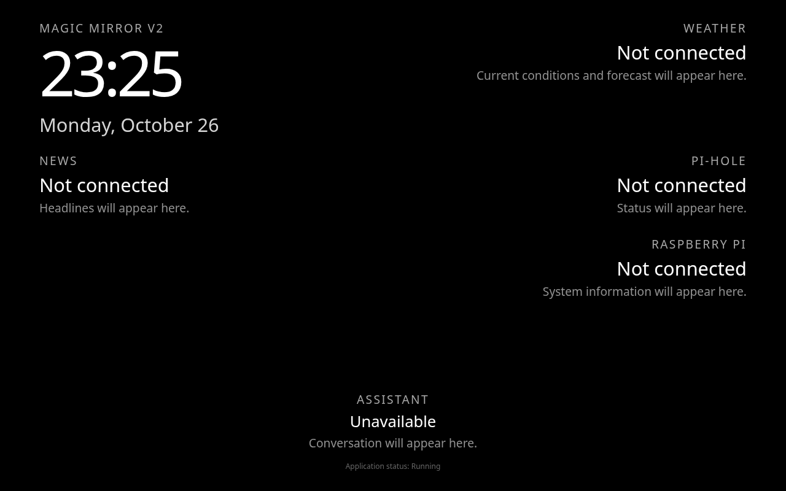

# Magic Mirror V2

Magic Mirror V2 is a local Flask dashboard for a Raspberry Pi 4B running 64-bit Debian 12 Bookworm. The clock and date use Chromium's local timezone. System information, weather, RSS headlines, and Pi-hole v6 data refresh independently in the background. Unconfigured or unreachable sources show unavailable or stale states. The assistant remains a placeholder.



Preview captured in headless Chromium during development. Check contrast and spacing on the installed mirror display before approval.

## Requirements

- Python 3.11 or newer (Debian 12 supplies 3.11)
- `python3-venv` and `python3-pip` from Debian, if they are not already installed
- Network access to PyPI for the first dependency installation
- No root access to run the application
- `libportaudio2` on the Pi for microphone and speaker tests (check with `dpkg-query -W libportaudio2`)

Runtime libraries are Flask, python-dotenv, psutil, requests, defusedxml, gpiozero, lgpio, sounddevice, and NumPy. `pytest` is used for development. `requirements.txt` pins direct and transitive Python packages to tested versions; it does not install system packages. GPIO and audio streams remain closed until explicitly requested.

## Project layout

```text
magic_mirror/
  __main__.py           manual startup and shutdown
  app.py                Flask application factory
  config.py             environment configuration and logging
  data.py               background refresh schedules and cached snapshots
  providers/            read-only system, weather, news, and Pi-hole sources
  hardware/             RGB LED controller and standalone hardware test command
  audio/                device selection, bounded capture/playback, PCM gain, test CLI
  dashboard/            routes, template, local CSS, and small JavaScript modules
tests/                  hardware-free application and configuration tests
scripts/run_pi.sh       manual Raspberry Pi launcher
.env.example            safe local configuration example
requirements.txt        pinned Python dependencies
```

Future dashboard features belong under `magic_mirror/dashboard/`. The assistant integration can be added separately when its requirements are defined.

## Raspberry Pi installation

On a Pi with the repository already cloned, run these commands as your normal user from the repository directory:

```bash
cd magic_mirror_v2
python3 --version
python3 -m venv .venv
.venv/bin/python -m pip install --upgrade pip
.venv/bin/python -m pip install -r requirements.txt
test -f .env || cp .env.example .env
.venv/bin/python -m pytest -q
./scripts/run_pi.sh
```

If `python3 -m venv .venv` reports that `ensurepip` is unavailable, install Debian's `python3-venv` package using your normal package administration process, then repeat the command. No system Python packages are changed by the commands above. The `.env` command preserves an existing local configuration. The launcher changes into the project directory and uses its `.venv`. Existing installations should rerun `.venv/bin/python -m pip install -r requirements.txt` for the current dashboard, LED, and audio dependencies. If `libportaudio2` is missing, have the Pi's package administrator install that Debian package separately.

## Manual operation

With the default `.env`, open `http://127.0.0.1:5000/` in Chromium on the Pi. Check the server from a second terminal:

```bash
curl --fail --silent http://127.0.0.1:5000/health
```

The expected response is `{"status":"healthy"}`. Stop the foreground server with **Ctrl+C**. You can also start it directly with `.venv/bin/python -m magic_mirror`. The server binds to `127.0.0.1` by default. To bind elsewhere, explicitly set `MIRROR_HOST` in `.env` or the process environment. Process environment variables take precedence over `.env`. `.env` is local and ignored by Git.

| Setting | Default | Purpose |
| --- | --- | --- |
| `MIRROR_HOST` | `127.0.0.1` | Bind address; change explicitly to expose the server. |
| `MIRROR_PORT` | `5000` | HTTP port, 1–65535. |
| `MIRROR_LOG_LEVEL` | `INFO` | Application log level. |
| `MIRROR_CLOCK_FORMAT` | `24` | `12` or `24` hour clock. |
| `MIRROR_DISPLAY_SCALE` | `1.0` | Optional text scaling, from `0.75` to `1.5`. |
| `MIRROR_MODULES` | `weather,news,pihole,system,assistant` | Comma-separated regions to show; empty hides all optional regions. |
| `MIRROR_WEATHER_LATITUDE`, `MIRROR_WEATHER_LONGITUDE` | blank | Set both coordinates to enable Open-Meteo. No physical location is assumed. |
| `MIRROR_WEATHER_UNIT` | `celsius` | `celsius` or `fahrenheit` for the Open-Meteo response and existing JSON fields. The display always puts °C first and °F second. |
| `MIRROR_NEWS_FEEDS` | blank | Up to five comma-separated HTTPS or HTTP RSS/Atom URLs. |
| `MIRROR_PIHOLE_URL` | `http://127.0.0.1` | Pi-hole v6 API base address on the same Pi. |
| `MIRROR_PIHOLE_PASSWORD_FILE` | blank | Optional absolute path to a local Pi-hole v6 application password file. |
| `MIRROR_PIHOLE_CA_CERT` | blank | Optional absolute path to a readable trusted CA certificate file for Pi-hole HTTPS. Requires an HTTPS Pi-hole URL. |
| `MIRROR_SYSTEM_INTERVAL` | `15` | System refresh seconds, minimum 5. |
| `MIRROR_WEATHER_INTERVAL` | `900` | Weather refresh seconds, minimum 300. |
| `MIRROR_NEWS_INTERVAL` | `1800` | News refresh seconds, minimum 300. |
| `MIRROR_PIHOLE_INTERVAL` | `60` | Pi-hole refresh seconds, minimum 15. |
| `MIRROR_LED_ENABLED` | `false` | Claim GPIO on Flask startup only when explicitly `true`. |
| `MIRROR_LED_RED_PIN`, `MIRROR_LED_GREEN_PIN`, `MIRROR_LED_BLUE_PIN` | `22`, `27`, `24` | Distinct BCM GPIO numbers, each 0–27. Physical pins 15, 13, 18 on the tested Pi 4B. |
| `MIRROR_LED_ACTIVE_HIGH` | `true` | `true` for the verified active-high LED; `false` for active-low wiring. |
| `MIRROR_LED_INITIAL_STATE` | `off` | `idle`, `listening`, `responding`, or `off` when GPIO is first enabled. All channels initialize off before this state is applied. |
| `MIRROR_AUDIO_ENABLED` | `false` | Allow in-process audio stream starts; Flask never opens a stream automatically. The explicit test CLI works while this is `false`. |
| `MIRROR_AUDIO_INPUT_DEVICE` | `USB PnP Sound Device` | PortAudio microphone name or unique substring; optional `HostAPI:name` to disambiguate. No automatic fallback. |
| `MIRROR_AUDIO_OUTPUT_DEVICE` | `MAX98357A` | PortAudio speaker name or unique substring; optional `HostAPI:name`. No HDMI fallback. |
| `MIRROR_AUDIO_CAPTURE_RATE`, `MIRROR_AUDIO_PLAYBACK_RATE` | `48000`, `48000` | Hz, each 8000–96000; the selected PortAudio devices must support the requested values. Replay requires matching rates. |
| `MIRROR_AUDIO_CAPTURE_CHANNELS`, `MIRROR_AUDIO_PLAYBACK_CHANNELS` | `1`, `1` | Mono by default; each may be 1 or 2 if supported by the device. Replay requires matching channels. |
| `MIRROR_AUDIO_BUFFER_DURATION` | `0.1` | Callback buffer duration in seconds, 0.02–1.0; up to eight buffers are queued per direction. |
| `MIRROR_AUDIO_FRAME_FORMAT` | `int16` | `int16` or `float32` PCM. |
| `MIRROR_AUDIO_PLAYBACK_GAIN` | `1.0` | Software speaker gain, 0–4. A value of `2.0` is about +6 dB before limiting. |
| `MIRROR_AUDIO_MAX_PLAYBACK_LEVEL` | `1.0` | Peak ceiling, 0.1–1.0 of full scale; samples saturate before integer conversion. |
| `MIRROR_AUDIO_TIMEOUT` | `5.0` | Seconds, 0.1–30, for waiting on capture, playback queue space, and drain. |

The clock uses the Pi's configured local timezone through Chromium. Change the Pi's system timezone if the clock shows the wrong local time, then refresh Chromium. The clock checks the current time at minute boundaries and refreshes when the page becomes visible again. The browser requests one cached `/api/dashboard` JSON snapshot every 15 seconds while visible. Up to four background workers, one per enabled data provider, run on independent schedules; they never run in page routes or overlap their own refreshes. Successful snapshots stay in memory until the process exits; failed refreshes retain last-known-good values with a stale label and a UTC last-success timestamp. The endpoint returns data only, never feed URLs, coordinates, passwords, or session IDs. No external HTTP requests occur during application initialization or page rendering.

On shutdown, all workers receive a stop signal and no new refresh starts. The application waits up to seven seconds in total for active work. If a bounded network call lasts longer, the coordinator reports that workers are still alive and retains their handles; another `stop()` can wait again, and `start()` refuses to create replacements until those workers finish. When the foreground Flask process exits, any remaining daemon worker ends with that process. This does not alter Pi-hole or other services.

Open-Meteo supplies current temperature, condition, high/low, feels-like when available, and tomorrow's short forecast. Each weather reading shows Celsius in larger white type followed by Fahrenheit in smaller gray type. Both values are calculated from the same response; no second API request is made. Existing JSON fields (`temperature`, `high`, `low`, `feels_like`, and `unit`) keep their configured source units; additional `_c` and `_f` fields supply the dual display. RSS/Atom feeds supply at most three deduplicated titles with publisher and publication time when available. News text is inserted as text, and article scripts or images are never loaded. The Pi-hole provider implements the v6 `/api/stats/summary`, `/api/dns/blocking`, and session authentication contract documented by Pi-hole; it only reads statistics and blocking status after authentication. The system provider reads psutil and Linux thermal data without privilege. CPU temperature shows an unavailable marker if no sensor is present.

For a Pi-hole installation with a private CA, set `MIRROR_PIHOLE_URL=https://pi.hole` and point `MIRROR_PIHOLE_CA_CERT` to the absolute path of the trusted CA certificate file in the ignored local `.env`. Keep the CA certificate and application password in a private directory such as `.private/` (ignored by Git) or outside the repository, with permissions limited to the application user. The CA file must exist and be readable at startup. Pi-hole authentication, statistics, and blocking requests then verify HTTPS against that CA; an invalid certificate or hostname causes the Pi-hole module to become unavailable or stale. Without a custom CA, requests use the normal certificate trust store. Weather and news continue using their own normal certificate trust settings.

The RGB LED controller uses one `LGPIOFactory` and three gpiozero `LED` outputs. `idle` lights red, green, and blue (white); `listening` lights green; `responding` lights blue; `off` extinguishes all channels. Transitions turn obsolete channels off before lighting new ones. The main Flask process owns the controller only when `MIRROR_LED_ENABLED=true` and releases every pin on Ctrl+C, SIGTERM, or startup failure. The default is disabled and off. The assistant region remains an honest placeholder; no assistant event source or GPIO control route exists in this pass. Run the standalone hardware command only while Flask is stopped, so there is a single GPIO owner.

For exact Raspberry Pi LED test commands and acceptance checks, see [Pass 4 hardware validation](docs/PASS4_PI_VALIDATION.md).

Audio is owned by one in-process `AudioManager`, exposed to future internal integrations through `app.extensions["magic_mirror_audio"]`. It does not open a microphone or speaker on Flask startup, even when audio is enabled. Explicit start methods claim one capture and one playback owner process-wide; another attempt fails clearly. Capture reads bounded mono PCM frames or records up to 30 seconds in memory. Playback accepts bounded PCM, uses a maximum eight-buffer queue, and applies optional gain with saturation instead of integer wraparound. Cancel and shutdown abort and close both streams. The standalone CLI records nothing to disk and sends no audio over the network. No audio control HTTP route or assistant integration exists.

The USB microphone and MAX98357A defaults are **selection preferences**, not guaranteed PortAudio identifiers. PortAudio can expose ALSA devices, PipeWire/PulseAudio logical devices, or both under different names. A direct ALSA device may bypass PipeWire mixing and routing even if its card name resembles a PipeWire sink. Run the CLI device list and selection checks on the Pi, set exact unique PortAudio names in the ignored `.env`, then test each physical path. There is no automatic fallback to HDMI. The default 48 kHz mono format must be confirmed against the selected PortAudio device; unsupported settings fail rather than silently resample. For exact commands, see [Pass 5 audio validation](docs/PASS5_PI_VALIDATION.md).

For the hardware validation steps, including a private Pi-hole credential setup procedure and version check, see [Pass 3 Raspberry Pi validation](docs/PASS3_PI_VALIDATION.md).

This is Flask's manual server, intended for local development and hardware acceptance. There is no systemd unit or kiosk autostart configuration in Pass 3.

## Raspberry Pi display check

After starting Flask in one terminal, open `http://127.0.0.1:5000/` in Chromium on the Pi. For an optional temporary full-screen kiosk test, launch Chromium manually from the Pi's graphical session:

```bash
chromium --kiosk --app=http://127.0.0.1:5000/ --no-first-run --disable-session-crashed-bubble
```

Verify the live clock advances across a minute boundary without refresh, the date and 12/24-hour preference match `.env`, the black background fills the screen, every enabled region is readable from several feet away, and no scrollbars appear. Refresh once to confirm the layout and clock recover. Close the Chromium window, then press Ctrl+C in the Flask terminal and check that `/health` is no longer reachable. This command does not change Chromium startup settings.

## Troubleshooting

- A `Configuration error` names an invalid `MIRROR_HOST`, `MIRROR_PORT`, or `MIRROR_LOG_LEVEL`. Check `.env` and any exported environment overrides. Port must be an integer from 1 to 65535.
- `Address already in use` means the selected port is occupied. Choose a free port in `.env`; do not stop an unrelated service.
- `ModuleNotFoundError` usually means dependencies were not installed into `.venv` or the wrong Python interpreter was used. Repeat the installation command and launch through `scripts/run_pi.sh`.
- If Chromium cannot reach the page, verify `/health` locally first and make sure Chromium runs on the same Pi. Localhost binding intentionally does not expose the server to other devices.
- If LED startup reports a GPIO error, check the BCM pin numbers, wiring polarity, and that no other process owns those pins. Run the standalone LED test as the normal Pi user after stopping Flask. Do not use sudo.
- If audio discovery fails, use the standalone `audio_test list` command and set a unique PortAudio device name in `.env`. If PortAudio cannot load, check `dpkg-query -W libportaudio2`. Test a supported rate and channel count with `audio_test selected` before recording or playback.
- If dependency installation fails, verify Python is at least 3.11, PyPI is reachable, and `.venv/bin/python -m pip` is being used.
- If Pi-hole HTTPS is unavailable, check that `MIRROR_PIHOLE_CA_CERT` is an absolute path to the trusted CA certificate, readable by the Flask user, and that the certificate covers the hostname in `MIRROR_PIHOLE_URL`. Do not turn off certificate verification.

## Raspberry Pi acceptance checklist

- [ ] On 64-bit Debian 12, create `.venv` and install `requirements.txt` without changing system Python packages.
- [ ] Run all tests successfully on the Pi.
- [ ] Start `./scripts/run_pi.sh`; Chromium on the Pi displays the clock, date, and enabled data regions.
- [ ] Confirm the clock advances without refresh and uses the Pi's timezone; check both clock formats if desired.
- [ ] Confirm the layout is readable and free of scrollbars at the installed display resolution.
- [ ] `curl http://127.0.0.1:5000/health` returns `{"status":"healthy"}`.
- [ ] Press Ctrl+C; the server stops cleanly and releases its port.
- [ ] Confirm the application's default bind address is localhost and existing Pi-hole behavior is unaffected.
- [ ] Run the standalone RGB LED test on the Pi: white → green → blue → off, individual colors, Ctrl+C cleanup, and a repeat without reboot.
- [ ] If enabling the LED in Flask, confirm GPIO releases after Ctrl+C and the dashboard and Pi-hole continue working.
- [ ] List PortAudio devices, select the USB microphone and MAX98357A path, record five seconds, play a controlled tone, replay the sample, and repeat after Ctrl+C without restarting the Pi.
