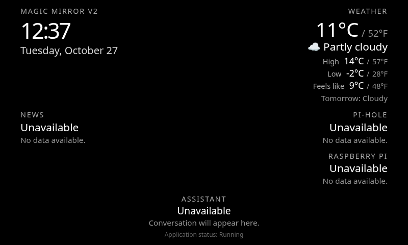

# Pass 3 Raspberry Pi validation

Run these checks in order on the Raspberry Pi 4B. They read system state and API data only. They do not change Pi-hole, DNS, Chromium startup, or system services.

## Common setup

From the repository directory on the Pi, update the PR branch and local virtual environment:

```bash
cd magic_mirror_v2
git fetch origin
git switch --track origin/pass-3-live-data
.venv/bin/python -m pip install -r requirements.txt
test -f .env || cp .env.example .env
.venv/bin/python -m pytest -q
./scripts/run_pi.sh
```

If this branch is already checked out, use `git switch pass-3-live-data`. Leave Flask running in this terminal. In a second terminal, use:

```bash
curl --fail --silent http://127.0.0.1:5000/health
curl --fail --silent http://127.0.0.1:5000/api/dashboard | .venv/bin/python -m json.tool
```

The health response is `{"status":"healthy"}`. `/api/dashboard` lists enabled data modules, their `ok`, `stale`, or `unavailable` status, `updated_at`, and safe data fields. Wait through the configured refresh interval after editing `.env`, then restart Flask to apply settings. The command above never returns private configuration or Pi-hole credentials.

## A. Raspberry Pi system information

With `system` in `MIRROR_MODULES`, inspect `modules.system` in `/api/dashboard` and the Raspberry Pi region in Chromium. Compare CPU, RAM, disk, and uptime with ordinary system tools if desired (`free -h`, `df -h /`, `uptime`). CPU temperature may be unavailable on an image without a usable sensor; the other metrics should continue to show. Confirm no elevated privileges are requested.

## B. Weather



This development preview uses mocked readings to check typography and spacing; validate real weather on the Pi using the steps below.

Edit the local ignored `.env` and set both `MIRROR_WEATHER_LATITUDE` and `MIRROR_WEATHER_LONGITUDE` to coordinates you choose. Set `MIRROR_WEATHER_UNIT=celsius` or `fahrenheit`. Restart Flask. Inspect `modules.weather` in `/api/dashboard` and the weather region in Chromium. Confirm current, high, low, and available feels-like readings show larger white °C beside smaller gray °F, with no clipping at the installed resolution. The original JSON temperature fields should still follow `MIRROR_WEATHER_UNIT`; `_c` and `_f` fields should show both conversions. Confirm condition and tomorrow's short forecast. Disconnect the Pi from the Internet temporarily only if it is safe for your test setup; after a failed refresh, the last successful weather snapshot should read `stale` while the clock and system region continue. Restore connectivity afterward. No default location is built in.

## C. News

Set `MIRROR_NEWS_FEEDS` in local `.env` to one or more RSS/Atom URLs you choose, separated by commas, then restart Flask. Inspect `modules.news.data.headlines` and the News region. Confirm titles and publishers, and publication times where the feed provides them. An unreachable or malformed feed must not hide healthy modules; if all feeds fail after earlier success, news should show stale results. The app does not fetch article pages, images, or scripts.

## D. Pi-hole

First check the installed version with `pihole -v` and consult the local v6 API contract in Chromium at `http://127.0.0.1/api/docs`. This provider targets Pi-hole v6; if the Pi is on v5 or uses a custom web port, record that for review before expecting v6 data. Set `MIRROR_PIHOLE_URL` in local `.env` to the Pi-hole base URL, such as `http://127.0.0.1`. The code calls only `GET /api/stats/summary` and `GET /api/dns/blocking` after optional `POST /api/auth` session creation. It never calls the blocking-changing POST route.

If the v6 read API requires authentication, create a Pi-hole **application password** in the Pi-hole web settings. Store it in a private file outside the repository. For example, from a Pi terminal:

```bash
install -m 700 -d "$HOME/.config/magic-mirror-v2"
umask 077
read -rsp 'Pi-hole application password: ' MIRROR_LOCAL_PASSWORD; printf '\n'
printf '%s' "$MIRROR_LOCAL_PASSWORD" > "$HOME/.config/magic-mirror-v2/pihole-password"
unset MIRROR_LOCAL_PASSWORD
chmod 600 "$HOME/.config/magic-mirror-v2/pihole-password"
```

Set `MIRROR_PIHOLE_PASSWORD_FILE` in `.env` to that file's **absolute** path, then restart Flask. Do not paste the password into `.env`, a URL, a command argument, Git, or a test report. Check that the Pi-hole region shows blocking state, total queries, blocked queries, and blocked percentage. A failed authentication should show unavailable or stale without affecting other regions. The code uses the session ID only in an HTTP header and does not expose it to the browser. Authentication over plain HTTP is accepted only for loopback URLs; use HTTPS for a nonlocal Pi-hole endpoint.

## E. Combined dashboard reliability

Open `http://127.0.0.1:5000/` in Chromium on the Pi, or use a temporary manual kiosk window:

```bash
chromium --kiosk --app=http://127.0.0.1:5000/ --no-first-run --disable-session-crashed-bubble
```

Confirm all configured modules update without a full-page reload, their text stays within the approved layout, and the clock advances independently. Refresh Chromium and repeat `/health` and `/api/dashboard`. For an outage test, remove a feed URL or temporarily make a configured source unreachable in `.env`, then restart only Flask and confirm the other modules and clock still work. An in-memory cache resets when Flask restarts, so to test a `stale` snapshot, interrupt a source during the same Flask run after a successful refresh. Close the kiosk window and press Ctrl+C in the Flask terminal. Confirm `/health` is no longer reachable. Do not use port-killing commands; if the configured port is occupied, select a free port in `.env`.
